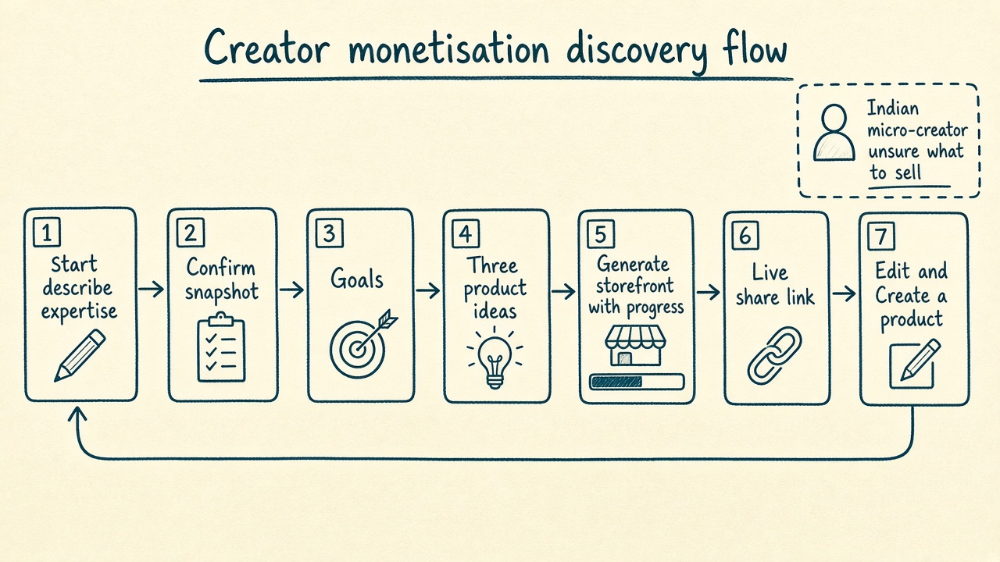
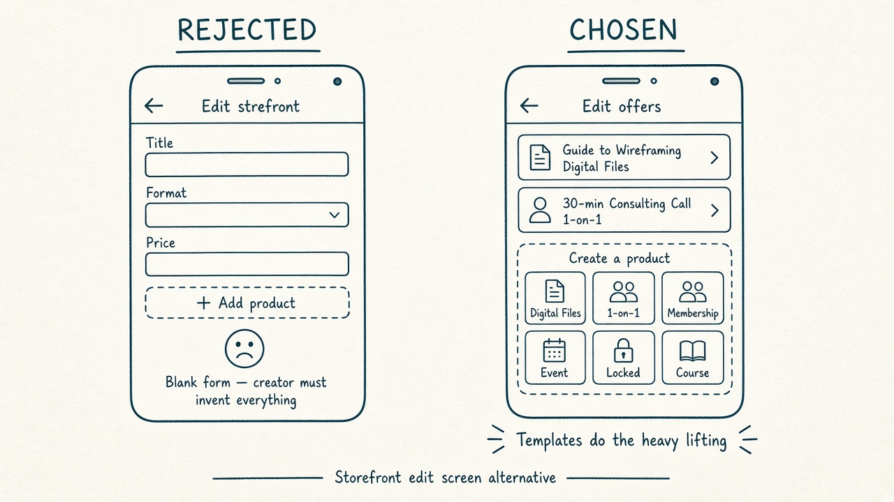

# AI Storefront Generator
### Product Decision Document
**SuperProfile by Cosmofeed | Product Manager Take-home Assignment**

## 1. Problem understanding

SuperProfile enables creators to monetise their expertise through courses, digital products, workshops, memberships and services.

However, creating a storefront requires several decisions: what to sell, whom to sell it to, how to price it and how to communicate its value. For creators who have never monetised their knowledge, these decisions can become barriers to getting started.

I believe the problem goes beyond building a webpage. It is about helping creators recognise what they can credibly offer and turning that knowledge into a clear, commercially sensible product.

**Problem hypothesis**

Indian micro-creators with an existing audience but limited monetisation experience struggle to translate their expertise and content into a product their audience might pay for. Uncertainty around product selection, pricing and communication makes starting a storefront overwhelming.

My approach is therefore to treat this as a creator monetisation discovery problem, rather than simply an AI website-generation problem.

### Assumptions

- The primary user is an Indian micro-creator with approximately 5K–100K followers.
- Creators have useful knowledge or experience but may not recognise it as something they can monetise.
- First-time creators may lack experience in product packaging, pricing and copywriting.
- Their audiences can be price-sensitive, making accessible entry-level products important.
- Experts without a meaningful social presence should also be able to use the product through documents, resources or self-description.
- After the first storefront exists, creators still need help expanding the store — blank “add product” screens recreate the original uncertainty.

These are working assumptions based on the assignment brief, not findings from completed primary user research.

## 2. User and the flow designed for them

The guiding principle is: **creators should not need to know how to define or package their expertise before using the product.**

### Primary user — Indian micro-creator

| | |
|---|---|
| **Who** | Creator with ~5K–100K followers (finance, fitness, cooking, exam prep, design, etc.) |
| **Context** | Already posts tips / explainers; gets DMs asking for help |
| **Job to be done** | Turn what I already teach into something people can pay for in ₹ |
| **Main friction** | “What do I sell? Who is it for? What should it cost? How do I explain it?” |
| **Device** | Mostly mobile; short sessions; low patience for jargon |
| **Success for them** | A shareable store link with a clear first offer they believe they can deliver |

**Example:** A personal-finance creator who explains budgeting and salary habits, but has never packaged a paid digital product.

### Secondary user — expert with little or no audience

| | |
|---|---|
| **Who** | Teacher, coach, CA, trainer — skilled, but weak social presence |
| **Context** | Helps people offline / on WhatsApp; may have PDFs or worksheets |
| **Job to be done** | Turn expertise + documents into a simple paid offer without needing Instagram |
| **Main friction** | No “content brand” to scrape; blank product forms feel intimidating |
| **Success for them** | Same outcome: confirmed summary → 3 ideas → live store page |

**Example:** A CA who teaches freelancers GST filing, with a small social following but daily client questions.

### Flow designed for them

I designed a **discovery → confirm → recommend → publish → grow** journey so the product does the packaging work, while the creator stays in control of truthfulness.

**Step-by-step (what the user experiences)**

1. **Start — understand the creator:** Paste a short description; optionally add screenshots, PDFs, captions, or public links. Instagram only when connected — a bare `@handle` does not invent a scrape.
2. **Snapshot:** AI extracts topics, problems people ask about, and reusable knowledge assets. Marks *observed* vs *inferred*.
3. **Confirm:** Creator fixes anything wrong before we recommend money products.
4. **Goals:** Light intent signal (e.g. “figure out what to sell”) — not a product-type quiz.
5. **Three ideas:** Offers in SuperProfile product types, with who it’s for, deliverables, and ₹ pricing (researched label only when citations exist).
6. **Generate storefront:** Real progress stages → mobile store page.
7. **Share:** Public URL that persists after deploy.
8. **Grow:** Edit mode + **Create a product** templates so adding a second offer isn’t a blank form.

### SuperProfile product types (MVP catalogue)

Recommendations, format dropdowns and **Create a product** use the same six types creators already see in SuperProfile:

| Product type | What it means in plain language |
|---|---|
| Sell Digital Files | Ebooks, PDFs, templates, images, videos |
| Offer 1-on-1 Session | Personal sessions for visitors |
| Recurring Membership | Ongoing group access (Telegram / Discord / WhatsApp style) |
| Host Event or Webinar | Live tickets, workshops, classes |
| Locked Content | Pay to unlock a specific file or drop |
| Sell a Course | Video collection or online classes |

Discovery still comes first. The catalogue is used *after* we understand the creator — in AI suggestions and when they choose to add another offer.

### Alternative considered for a main screen (edit / grow)

Assignment asks for at least one alternative on a main screen. I treated the **post-publish edit screen** as a main surface — it is where creators expand the store after their first win.

| | Rejected | Chosen |
|---|---|---|
| **Screen idea** | Classic “+ Add product” with empty title / format / price fields | **Create a product** panel with SuperProfile’s six types as ready drafts |
| **Creator effort** | Must invent name, format, deliverables, and ₹ price from scratch | Tap a type → draft appears → tweak wording |
| **Risk** | Recreates the original monetisation freeze (“I don’t know what to add”) | Mild risk of template sameness — mitigated by editable fields + regenerate |
| **Why rejected** | Blank forms help power users, not first-time sellers. After the first storefront, the product’s job is still to reduce thinking load, not hand them a spreadsheet. |
| **Why chosen** | Matches SuperProfile’s real catalogue language; keeps discovery-first onboarding; uses catalogue-first only when they already have a live store to grow. |

I also considered (and rejected) a **product-first onboarding** main screen (pick Digital Files / Course / etc. before describing expertise). That assumes they already know what to sell — the opposite of the problem hypothesis. Catalogue belongs after understanding, not before.

I avoided a long mandatory questionnaire. Optional guided questions and resource uploads help creators who cannot easily articulate their expertise.

## 3. Key product decisions and trade-offs

| Decision | Why I chose it | Trade-off |
|---|---|---|
| Discovery before product selection | Helps creators who don't know what to sell | Requires additional AI processing |
| Align formats with SuperProfile’s six types | Keeps the MVP coherent with the real product language | Older “ebook / workshop” labels needed migration |
| Multiple resource inputs | Supports social creators and experts without an online following | Requires resource extraction and validation |
| Editable AI profile | Lets creators correct inaccurate interpretations before recommendations | Adds a confirmation step |
| Evidence-backed AI + anti-hallucination scrub | Makes recommendations safer and more traceable | Slightly more pipeline complexity |
| External market research | Helps ground comparable products and listed prices | Search results can be incomplete or irrelevant |
| Three curated recommendations | Provides meaningful choice without overwhelming beginners | Fewer options than a full catalogue at first |
| Editable storefront + template “Create a product” | Lets creators grow the store without blank-page thinking | Needs clear edit mode and durable save |
| Durable public storefront storage | Share links must work after serverless deploy | Depends on Blob (or similar) persistence |

### Pricing decision

Pricing combines product format, deliverables, audience affordability, creator capability and available comparable listings.

A price is labelled as research-backed only when a relevant comparable product has a verifiable listed price. Otherwise, it remains an AI estimate.

I deliberately avoid treating listed prices as proof of actual sales or willingness to pay.

### Honesty on Instagram and progress

- A bare Instagram handle without connect shows a clear message — we do not pretend to scrape.
- Storefront generation progress mirrors real backend stages (prepare → write → assemble products → publish), not a fake spinner timeline.

## 4. AI architecture and quality control

The AI workflow uses separate stages so that unsupported assumptions do not become product recommendations.

**Stage A — Creator intelligence:** Extract information from uploaded images, documents, captions and accessible resources. Identify expertise, recurring content themes, potential audience problems and reusable knowledge assets.

**Stage B — Market research:** Use targeted Tavily searches to retrieve comparable public products, listed prices, formats and positioning.

**Stage C — Opportunity generation:** Combine the confirmed creator profile with supporting evidence and market findings to produce tailored product recommendations in SuperProfile product types.

**Stage D — Storefront copy:** Write bio, headline and product cards for the selected offer, with the same honesty rules.

**Structured output:** Use schema-constrained JSON and Zod validation for consistent fields, evidence references, pricing basis and product information.

**Anti-hallucination guardrails (shipped):**
- Shared rules injected into every major LLM call (discovery, intelligence, opportunities, storefront).
- Forbidden-claim checks (guaranteed returns, fake credentials, invented social proof, etc.).
- Soft scrub of hype phrases after generation.
- Drop opportunities that still carry unsupported claims.
- Treat uploaded text and captions as data to analyse — not as instructions that override rules.
- Distinguish observed facts from AI inferences; keep evidence references on insights.
- Label prices as estimates when comparable evidence is insufficient.
- Ask for clarification when source material is insufficient.

## 5. What I deliberately did not build

| Excluded feature | Reason |
|---|---|
| Unrestricted Instagram scraping | Platform and permission constraints; resource uploads and self-description provide alternatives |
| Payment processing | Not necessary to demonstrate the discovery-to-storefront journey (interest form is demo-only) |
| Full authentication system | Adds complexity without improving the core demonstration |
| Advanced analytics dashboard | Better addressed after successful storefront activation |
| Video transcription and extensive social listening | Higher processing complexity; prioritised images, text, documents and accessible links |
| Complex theme customisation | Prioritised one polished, shareable storefront |
| Unlimited product catalogue beyond SuperProfile types | Stay aligned with what SuperProfile already sells |

## 6. Success metrics

The primary outcome is to help more new creators publish a storefront in their first session, with less time and uncertainty.

### Metric 1: First-session storefront publication rate

**Proposed target: +20% relative improvement over the existing baseline.**

Formula:

New creators who publish a storefront in their first session ÷ New creators who start onboarding × 100.

For example, if the baseline is 20%, a 20% relative improvement means reaching 24%, not 40%.

**Measurement:**
Track `onboarding_started` and `storefront_published` with a session identifier and timestamps. Define a consistent session boundary, and compare new-creator cohorts using the existing experience against the AI-assisted experience.

### Metric 2: Median time to first published storefront

**Proposed target: 30% reduction against the existing baseline.**

Formula:

Median of (storefront_published timestamp − onboarding_started timestamp) for successfully published storefronts.

**Measurement:**
Track timestamps for onboarding start and successful publication. Compare the median for equivalent new-creator cohorts, while separately monitoring abandonment so a faster completion time does not hide a lower publication rate.

### Supporting signals (post-MVP)

- Share-link open rate (published URL actually loads for a second device).
- “Add another offer” usage after first publish.
- Rate of regenerated vs hand-edited offers.
- Incidence of blocked / scrubbed hallucinated claims in generation logs.

These are proposed experiment targets, not measured outcomes. The targets should be adjusted after establishing a reliable baseline.

## 7. Go-to-market thought

Start with a focused beta among existing SuperProfile creators, particularly first-time storefront builders in finance, fitness, cooking and education.

Position the experience around:

**"You don’t need to know what to sell. Start with what you already know."**

Measure completion, recommendation selection and creator feedback before expanding to more categories. Use the same SuperProfile product language in AI suggestions and post-publish **Create a product** so the MVP feels native to the platform, not a separate AI toy.

## 8. What I would do with two more weeks

**Week 1: Strengthen intelligence**
- Test across creator niches and different source types.
- Fix evidence extraction for screenshots and documents.
- Improve comparable-product matching and pricing reliability.
- Conduct usability sessions with first-time creators (especially “Add another offer”).

**Week 2: Improve activation**
- Refine storefront visual quality.
- Instrument the onboarding and publication funnel.
- Compare existing onboarding with research-assisted onboarding.
- Analyse recommendation acceptance, editing and catalogue adds.
- Explore language options and broader source support based on observed usage.
- Connect real SuperProfile checkout for one product type end-to-end.

## 9. Communication, confidence and how I would adjust my thinking

My central product decision is to solve monetisation uncertainty before storefront construction — then keep helping when creators expand the store.

I chose this direction because the creator's difficulty is not necessarily building a page; it is deciding what that page should sell, and later what to add next without a blank form.

I would defend this as a product hypothesis, not an established fact.

The most important assumptions to validate are:

1. Creators struggle more with identifying an offer than with constructing a storefront.
2. Research-backed suggestions are more useful than generic AI-generated product ideas.
3. A short confirmation step improves recommendation relevance enough to justify its additional friction.
4. Template-based “Create a product” using SuperProfile types increases second-offer creation without increasing bad / invented offers.

**What would change my thinking?**

- If research shows that creators already know what to sell but struggle with page creation, I would simplify discovery and prioritise storefront generation.
- If creators frequently reject the AI's understanding of their expertise, I would improve source collection and confirmation before adding more market research.
- If research-backed recommendations do not improve selection or publication rates, I would reconsider the additional research cost and latency.
- If creators consistently find the confirmation step unnecessary, I would test a shorter, optional confirmation experience.
- If creators ignore SuperProfile-aligned templates and prefer free-text only, I would reduce catalogue prominence and invest more in freeform editing.

My intent is not to defend every original choice regardless of evidence. It is to make deliberate decisions, measure their impact and adjust when user behaviour contradicts my assumptions.
